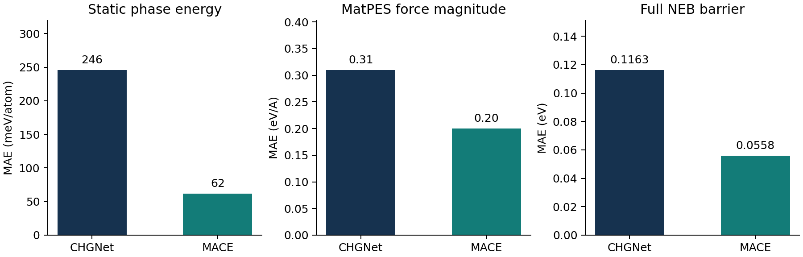

# FP-DeErr: reproduction and MACE evaluation

## Additional models completed October 28, 2026

MACE-OMAT-0 Medium (`default` head) and MACE-MH-1 (`omat_pbe` head) completed all twelve additional scientific stages. Both independent deep-source audits passed all eleven checks. Each model covers 6,697 static and relaxed structures, 434,712 MatPES-PBE structures, 117,004 OMat24 structures, and 154 static/full NEB paths. Medium retains two non-converged NEB paths and MH1 one, with zero failed paths.

- [Four-model comparison tables, exact checkpoints and audits](reports/additional-models/README.md)
- [Complete standardized results downloads](SUBMISSION.md)
- [Proposed upstream leaderboard update](https://github.com/mogroupumd/FP-DeErr/pull/1)

The supplied reference populations, fixed cells, optimizer settings and metric definitions were preserved. Float64 CPU/CUDA execution and saved-tensor storage adaptations have accompanying calibration proofs. Dependency differences, training overlap and PBE/PBE+U reference differences remain documented. The results are submitted for maintainer review; upstream inclusion is a separate decision.

Completed reproduction with **CHGNet 0.3.0**, followed by evaluation of **MACE-OMAT-0 Small** using the same FP-DeErr reference data and metric definitions.

**11/11 required stages complete · 16/16 final audit checks passed · 6-page report reviewed**

[Read the full report](reports/report.md) · [Download the PDF](reports/report.pdf) · [All metric tables](results/tables) · [Reproduction commands](REPRODUCING.md)

## Key comparisons

Lower MAE is better. Percentages below measure agreement with the reference data.

| Metric | Fresh CHGNet | MACE-OMAT-0 Small |
| --- | ---: | ---: |
| Static phase-stability energy MAE (meV/atom) | 246 | 62 |
| Static ordering energy MAE (meV/atom) | 270 | 51 |
| Relaxed phase-stability energy MAE (meV/atom) | 241 | 97 |
| Relaxed ordering top-1 accuracy (%) | 7.5 | 24.9 |
| MatPES-PBE force-magnitude MAE (eV/A) | 0.31 | 0.20 |
| OMat24 force-magnitude MAE (eV/A) | 0.76 | 0.14 |
| Full NEB barrier MAE (eV) | 0.1163 | 0.0558 |
| NEB energy-profile shape agreement (%) | 94.0789 | 92.7632 |

MACE improves the selected energy and force errors, but does not improve every metric. The full tables include all measured outcomes.

## What reproduced, and what differed?

CHGNet reproduced **11/11 displayed static phase/order metrics** and **8/8 displayed force cells on each dataset**. Static NEB barrier metrics also matched. Full-relaxation and geometry results differed from published values: phase relaxation matched 4/9 displayed values, ordering relaxation 2/7, and NEB 9/18 leaderboard fields, including coverage counts. Fresh CHGNet full NEB barrier MAE was 0.1163 eV versus 0.1161 eV published. These differences are documented rather than treated as exact reproduction.

## Coverage

Both models were evaluated on all required populations:

| Workflow | Population per model |
| --- | ---: |
| Phase stability and ordering, static and relaxed | 597 phase structures + 6,100 ordering structures |
| MatPES-PBE forces | 434,712 structures |
| OMat24 rattled-1000 forces | 117,004 structures |
| NEB | 154 paths and 1,078 static reference images |

Both full NEB runs finished with **152 converged paths, 2 non-converged paths and 0 calculation failures**. Non-converged paths are retained; barrier metrics use the upstream converged-path population.

## Interpretation and verification

- MACE-OMAT-0 was trained on OMat24. Exact structure-level training overlap across these benchmarks remains unaudited; these are not established out-of-distribution results.
- MACE targets PBE/PBE+U labels; MatPES-PBE supplies PBE labels. Reference-functional differences can affect comparisons.
- The [final scientific audit](validation/scientific_audit.json) checked full population coverage, original reference forces/source IDs, raw-result integrity, checkpoint hashes and the unchanged upstream commit. It recomputed all force metrics and the additional-model NEB leaderboard.
- CPU/GPU execution adaptations, precision, convergence thresholds and validation limits are documented in the report. Optional new VASP diagnostics were not required or run.

## Reproduce or inspect

Start with [REPRODUCING.md](REPRODUCING.md) and the detailed [WORKFLOW.md](WORKFLOW.md). The calculation scripts are at the repository root and the environment requirements are pinned separately by stage. Clone [FP-DeErr](https://github.com/mogroupumd/FP-DeErr) into `FP-DeErr/` and use upstream commit `0d5d9a62d0ef3b7ce4da58620a7919e0e49ba815`.

This compact review repository contains the report, tables, portable stage summaries, audit records and calculation code. Model weights, source datasets and per-structure raw results are excluded. Rerunning the full source audit requires the retained raw results or regenerated predictions. [The evidence index](results/evidence_index.json) records original audited summary hashes and review-copy hashes; only workspace prefixes in path strings were removed from the stage summaries. Private correspondence and process-control history are excluded.

The upstream FP-DeErr source remains unchanged. Its MIT license is included in [LICENSE](LICENSE); copyright belongs to the upstream authors. Additional model source: [MACE foundations](https://github.com/ACEsuit/mace-foundations).
